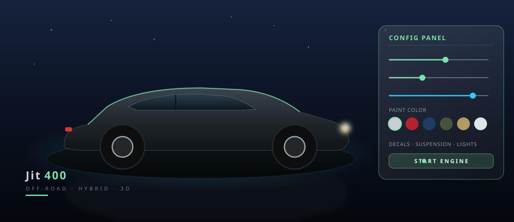
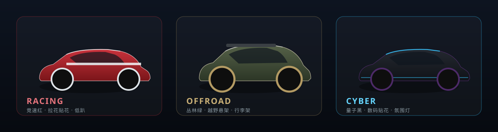
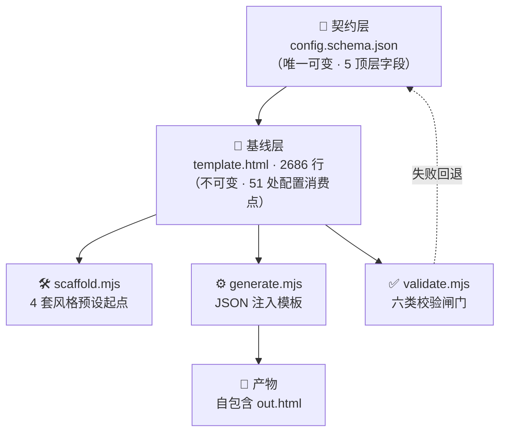
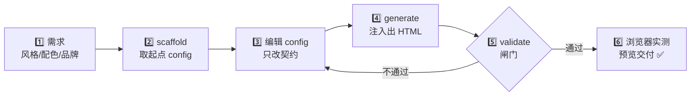

<div align="center">

# 🏎️ 3D-Car-Skill

**一个配置 JSON，撬动一整页可交互、可动画的品牌 3D 汽车落地页。**

*Turn a single config file into a fully interactive 3D car configurator — no Three.js experience required.*


</div>



---

## ✨ 这是什么

我们把一个 **2686 行**的 Three.js 3D 汽车程序，封装成了一个 **任何一个 AI agent 都能秒用的 Skill**。

你不需要懂相机矩阵、不需要理解 PBR 材质、更不需要从零写车身网格——只要描述「什么品牌、什么配色、什么氛围」，它就能产出一个**零构建、自包含的单 HTML 文件**：浏览器双击即跑，车是程序化生成的，能 360° 环绕、能改车漆、能贴花、能点开车门看内饰。

> 💡 核心理念：**别写 3D 代码，用配置驱动一个会写 3D 代码的能力。**

---

## 🚀 30 秒上手

```bash
# 1) 取一份起点配置（内置 4 种风格预设）
node scripts/scaffold.mjs racing > my.config.json

# 2) 把配置注入模板，生成页面
node scripts/generate.mjs my.config.json out.html

# 3) 交付前强制校验（不通过不放行）
node scripts/validate.mjs out.html
```

双击 `out.html`，或起个本地服务预览：

```bash
python3 -m http.server 8080   # 打开 http://localhost:8080/out.html
```

> 🎁 仓库里已附带成品示例 **`aurora.html`**（Aurora 品牌 · 冰蓝+白双色 · 月夜氛围），可直接打开体验。

---

## 🎨 一套模板，多种皮肤

同一个 Skill，改几行配置就能切换完全不同的品牌气质：



| 预设 | 气质 | 关键配置 |
|------|------|----------|
| `racing` | 竞速 · 低趴 · 拉花 | `finish:pearl` `decal:racing` `suspension:low` |
| `offroad` | 越野 · 高悬 · 机甲 | `finish:matte` `decal:mecha` `suspension:off` |
| `cyber` | 赛博 · 深色 · 氛围灯 | `decal:digital` 冷色天幕 |
| `default` | 原色 · 曜石银战舰 | 模板内置配色 |

---

## 🧩 能力全景

<table>
<tr>
<td width="50%">

### 🚗 程序化 3D 车辆
- 参数化车身轮廓（贝塞尔车头 + 轮拱圆弧挤出）
- 物理车漆 `clearcoat` · 玻璃 `transmission`
- 车门 / 尾门**可点击开启**，看内饰
- 轮毂转动、刹车点头、引擎抖动

</td>
<td width="50%">

### 🎛️ 交互控制台
- 主体色 / 副色 / 轮毂 / 卡钳 **四组色板**
- 6 位置车身贴花 + 上传图片 + 重复/偏移/透明度
- 悬架高度、前轮转向、模型缩放、车身角度
- 相机俯仰 / 距离 / 快速机位 + 自动环绕

</td>
</tr>
<tr>
<td>

### 💡 灯光与氛围
- 三段渐变天幕 + 体积雾
- 大灯 / 刹车灯 / 尾灯随速度联动
- 蓝灯呼吸、底盘氛围灯
- ACES 电影级色调映射

</td>
<td>

### 🛡️ 工程可靠性
- 契约 + 兜底默认，配置缺字段也不崩
- `validate.mjs` 六类校验闸门
- `node --check` 内联脚本语法体检
- 三处冗余版权署名，防篡改

</td>
</tr>
</table>

---

## 🏗️ 架构：三层解耦



**为什么是「模板 + 注入」而不是「让 agent 现写代码」？**
> 现写代码不可复现、还烧 token。模板固化了最脆弱的 2686 行 3D 逻辑，把不确定性全部赶进一小份受校验的 JSON——**同配置必得同产物**，这就是「高可用」三个字的落地。

---

## 🔄 工作流程



---

## ⚙️ 配置契约

使用者只碰这一份 JSON，五个顶层字段覆盖绝大多数定制需求：

| 字段 | 作用 | 常用子字段 |
|------|------|-----------|
| `meta` | 页面元信息 | `title` · `copyright` · `lang` |
| `branding` | 左下角 HUD 品牌文案 | `titleMain` · `titleAccent` · `titleSuffix` · `hudSubtitle` |
| `palette` | 四组可定制色板 | `mainColors` · `accentColors` · `wheelColors` · `caliperColors` |
| `initial` | 打开页面时的初始状态 | `paint` · `finish` · `tint` · `decal` · `suspension` · `engineOn` · `speed` |
| `scene` | 场景氛围 | `background.top/mid/bottom` · `fogColor` · `exposure` |

```json
{
  "branding": { "titleMain": "Aurora", "titleAccent": "Lunar", "titleSuffix": "月光座驾" },
  "palette":  { "mainColors": [ { "name": "冰湖蓝", "c": "#8ec5e8" }, { "name": "月光白", "c": "#eef4f8" } ] },
  "initial":  { "paint": "#8ec5e8", "finish": "pearl", "engineOn": true, "speed": 30 },
  "scene":    { "background": { "top": "#16233d", "mid": "#0a1120", "bottom": "#04070c" } }
}
```

> 📌 规则：颜色一律 `#RRGGBB`；留空的色板数组自动回退内置配色；完整约束见 `config.schema.json`。

---

## 🎚️ 定制深度分级

| 级别 | 场景 | 做法 | 谁来做 |
|------|------|------|--------|
| **L1 配置化** | 换品牌 / 配色 / 初始姿态 / 氛围 | 只写 `config.json` | 任何人 · agent |
| **L2 模板派生** | 新增贴花图案、加一组控件 | 复制模板按扩展配方小改 | 前端 |
| **L3 深度改造** | 改车身轮廓比例、接 GLTF 实车模型 | 动 `BODY` 参数 / 材质库 | 图形工程师 |

> 设计哲学：**越脆弱的操作，自由度越低；越常见的操作，越傻瓜。**

---

## 🧠 企业级高可用 Skill 的 6 条设计铁律

这份 Skill 也是「如何设计一个可交给别人 / agent 稳定使用的能力」的活教材：

1. **契约与实现分离** — 可变面收窄到一份 schema，模板是「不可变基线」。
2. **全消费点兜底默认** — 51 处读取点每个都有 fallback，最坏回退而非白屏。
3. **自由度分级** — L1/L2/L3，别让新手碰炸点，也别让老手束手束脚。
4. **失败可校验** — `validate.mjs` 强制闸门 + 浏览器实测反馈闭环。
5. **渐进式披露** — `SKILL.md` 仅 69 行，细节下沉 `reference.md` / `examples.md`，省 token。
6. **可发现 + 防篡改** — 描述写清 WHAT/WHEN 触发词；版权三处冗余署名。

---

## 🐛 我们踩过的 3 个静默 bug（干货）

三个都是**不报错但结果全错**的静默失败，全靠浏览器实测 + 校验闸门逼出：

| Bug | 现象 | 根因 | 修复与教训 |
|-----|------|------|-----------|
| 版权正则吞注释 | 整页白屏、控制台零报错 | `[^<\n]*` 把 `-->` 一起吃掉 | 只替换赋值本体；版权交运行时驱动 |
| 块注释未闭合 | 配置被静默丢弃 | 拼接 `BEGIN` 锚点漏了 `*/` | 校验加「注释配平 + 闭合」断言 |
| 动态色板无色 | 4 个色块透明空框 | `createElement` 重建时漏写 `--c` | 动态渲染务必与静态基线逐项对齐 |

> 🔑 一句话：**没有反馈闭环的自动化，只是在更快地生产事故。**

---

## 📦 仓库结构

```
3D-Car-Skill/
├── SKILL.md                # 主入口 · 流程与最小配置（69 行）
├── config.schema.json      # 唯一可变层的字段契约
├── template.html           # 不可变基线 · 2686 行 3D 汽车
├── reference.md            # 架构 / 建模原理 / 扩展配方 / 故障排查
├── examples.md             # 端到端示例 + 需求→字段映射
├── examples/               # 现成风格预设配置（racing / cyber）
├── scripts/                # scaffold / generate / validate
├── assets/                 # 本文配图（hero / presets）
├── aurora.html             # ✅ 成品示例：Aurora 品牌 · 冰蓝+白 · 月夜氛围
├── aurora.config.json      # 上面这个页面背后的配置
├── 3d-skill.html           # 最初的手写 3D 原型（Skill 的灵感来源）
├── LICENSE                 # MIT
└── README.md               # 你正在看的这份
```

> ▶️ 上手三条命令均在 **仓库根目录**直接执行（`scripts/` 与 `template.html` 同级）：
> `node scripts/generate.mjs my.config.json out.html`。
> `aurora.html` 是现成成品，双击即可预览，无需任何构建。

---

## 🌍 应用场景

- 🚙 **车型发布 / 预售落地页** — 换品牌名 + 主色，分钟级出片
- 🏁 **经销商交车演示** — 默认点火、行进姿态，客户一开屏车就在动
- 🖥️ **展会互动大屏** — 观众自助拖转、改色、点门看内饰，零学习成本
- 🎽 **品牌周边 / 战队应援页** — 贴花 + 配色 + HUD 全可换
- 🎨 **设计提案可视化** — 客户「换个颜色看看」当场演示
- 🤖 **无 3D 背景的 agent 自动产出** — 能力被沉淀，人人可调用

---

## 📄 License & Credits

Released under the **MIT License**.

Copyright © **JitWord 协同AI团队** · Built with Three.js + ❤️

<div align="center">

**如果这个项目对你有帮助，点个 ⭐ Star 是我们持续迭代的最大动力。**

</div>
